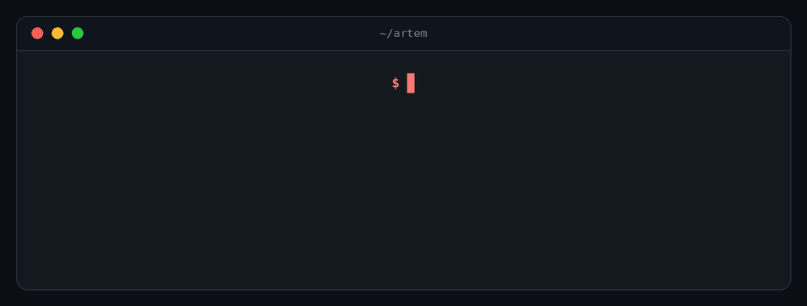

 

# Artem Ivanov

**Aspiring developer · DevOps · Competitive programming**

First-year Information Systems and Technologies student at FEFU, Vladivostok

 

---

## 👋 About me

I'm a goal-driven IT student who has spent several years growing in programming and DevOps, taking part in olympiads and hackathons. I like understanding how things work under the hood: from algorithms and data structures to how code gets packaged, shipped and run.

My goal is to grow into a **Junior developer** and keep building a strong base in both backend and DevOps.

## 🎯 What I do

| | |
|---|---|
| 💻 **Programming** | C++ and Python, from olympiad tasks to backend development |
| 🧠 **Algorithms** | Algorithms and data structures, competitive programming |
| 🐳 **DevOps** | Containers with Docker, Linux environments, version control with Git |
| 🏁 **Hackathons** | Working in a team under time pressure, leading and shipping a backend |

## 🛠 Tech stack

| | |
|---|---|
| **Languages** | C++, Python |
| **DevOps** | Docker, Git, Linux |
| **Competitive programming** | Algorithms and data structures |
| **Spoken languages** | English (B2), German |

## 🚀 Featured

### News analytics for business decision-making
**Hackathon "Alfa Future", 2026** · role: **Team Leader, Backend developer**

A team project built at the Alfa Future hackathon: a news analytics solution that helps make business decisions. I led the team and was responsible for the backend.

> More projects are on the way. Check my [repositories](https://github.com/clearstate?tab=repositories).

## 🏆 Achievements

- 🥇 **Hackathon "Alfa Future" (2026)**: participant, Team Leader and Backend developer.
- 🧩 **All-Russian School Olympiad in Informatics** (programming track): multiple-time participant.

## 📚 Learning

- 🎓 **Far Eastern Federal University (FEFU)**: Information Systems and Technologies, 2026 – present
- 🔧 **TOP IT**: DevOps track, ongoing
- 📘 **Stepik**: *C++ from Scratch* and *C++ for Professionals*

<b>🔭 Currently focused on</b>

 

- Deepening DevOps skills: Docker, Linux, Git workflows
- Advanced C++ and algorithmic problem solving
- Building real projects to put into my portfolio
- Getting from student to Junior

## 📊 GitHub stats

 

## 📫 Get in touch

Open to talking about backend, DevOps, olympiads and hackathons. The fastest way to reach me is [Telegram](https://t.me/diamondtearzz).

---

*investing knowledge in the code.*

